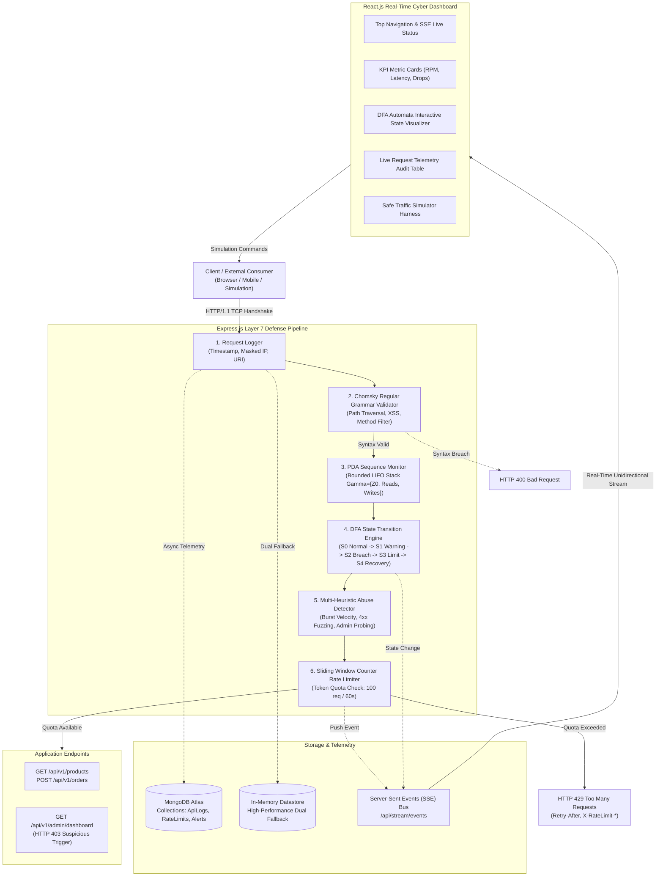
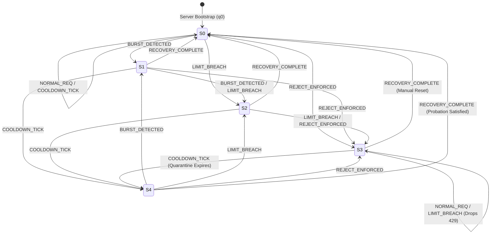
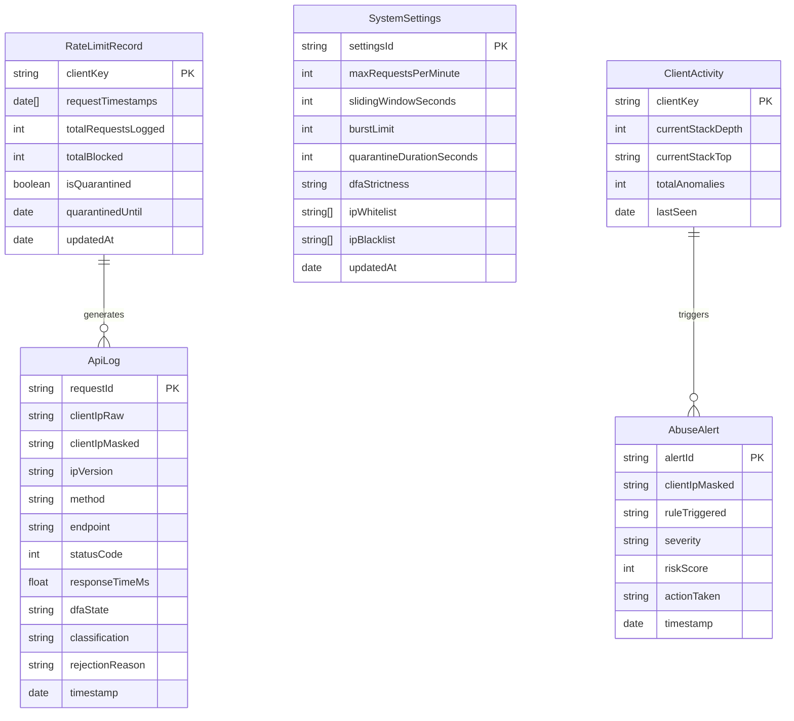

# Academic Project Report: REST API Rate Limiting and Abuse Detection System (SENTINEL)

**Bachelor of Technology in Information Technology (Third Year)**  
**Capstone Full Stack Web Development Project**  
**Author:** Vijay V  
**Academic Disciplines Integrated:** Full Stack Web Development, Computer Networks, Formal Languages & Automata Theory  

---

## 1. Abstract

Application Programming Interfaces (APIs) represent the primary conduit for data exchange in modern cloud-native software architectures. However, publicly accessible REST endpoints remain acutely vulnerable to distributed denial-of-service (DDoS) floods, credential brute-forcing, automated scraping bots, and directory traversal fuzzers. Traditional mitigation systems either operate exclusively at transport layers without awareness of application semantics or deploy opaque, resource-intensive machine learning algorithms that lack deterministic explainability.

This project introduces **SENTINEL**, an interdisciplinary, production-ready Full Stack Web Application that integrates concepts from **Full Stack Engineering**, **Computer Networks**, and **Formal Languages and Automata Theory (FLAT)**. SENTINEL implements an asynchronous, non-blocking middleware architecture in Node.js and Express that enforces sliding-window counter rate limits (100 req/min per client), evaluates multi-heuristic abuse patterns, executes Deterministic Finite Automata (DFA) state machines $M = (Q, \Sigma, \delta, q_0, F)$ across five operational states ($S_0$ through $S_4$), validates bounded request sequences via Pushdown Automaton (PDA) stack models, and enforces Chomsky Type-3 regular grammars on URI paths. Telemetry is streamed in real time via Server-Sent Events (SSE) to an interactive, cyber-themed React dashboard.

---

## 2. Problem Statement

Modern microservice ecosystems and public REST APIs face significant threats:
1. **Uncontrolled Resource Exhaustion:** Malicious or poorly designed clients flood APIs with high-velocity request loops, depleting database connection pools, memory, and CPU cycles.
2. **Reconnaissance & Directory Fuzzing:** Automated security scanners continuously probe undocumented endpoints (e.g., `/admin`, `/.env`, `/config`) causing excessive HTTP 4xx error rates and server strain.
3. **Lack of Explainability:** Many enterprise web application firewalls (WAFs) utilize proprietary heuristics that produce arbitrary false-positive blocks without providing structured RFC-compliant backpressure headers (`Retry-After`, `X-RateLimit-*`).
4. **Academic Disconnect:** Computer science curricula frequently isolate Computer Networks (OSI layers, TCP congestion control, IP addressing) and Automata Theory (DFA, PDA, formal grammars) as abstract mathematics rather than applying them directly inside real-world Full Stack web systems.

---

## 3. Project Objectives

1. **Develop an Extensible Full Stack Architecture:** Implement a clean client-server architecture with React.js (Vite) frontend, Express.js middleware pipeline backend, and MongoDB document database with in-memory fallback.
2. **Enforce Configurable Sliding Window Rate Limiting:** Implement microsecond-precise sliding window counter algorithms providing automated HTTP 429 backpressure and RFC 6585 compliance.
3. **Deploy Deterministic Finite Automaton (DFA) State Tracking:** Classify system and client states through a mathematically deterministic 5-tuple finite state machine transitioning across Nominal ($S_0$), Warning ($S_1$), Threshold Exceeded ($S_2$), Rate Limited ($S_3$), and Recovery ($S_4$).
4. **Implement PDA Sequence & Regular Grammar Validation:** Apply bounded Pushdown Automata stack models to identify unbalanced operation sequences and Type-3 regex filters to block lexical vulnerabilities (directory traversal, SQLi, and XSS).
5. **Bridge Computer Networks Semantics:** Differentiate Layer 7 application rate limiting from Layer 4 TCP congestion control, integrate IPv4/IPv6 dual-stack addressing with SHA-256 privacy masking, and provide Quality of Service (QoS) tiering.
6. **Construct a Real-Time Cyber Monitoring Dashboard:** Build a high-performance, dark navy dashboard displaying real-time metrics, live SSE audit logs, interactive automata graphs, and a safe traffic simulation test harness.

---

## 4. Existing System vs. Proposed System

| Dimension | Existing Conventional Systems | Proposed System (SENTINEL) |
| :--- | :--- | :--- |
| **Rate Limiting Approach** | Fixed-window counters subject to burst boundary vulnerabilities at window resets | High-precision **Sliding Window Counter** evaluating rolling microsecond timestamps |
| **Abuse Detection** | Static IP blocklists or opaque machine-learning models lacking clear explanation | **Explainable Multi-Heuristic Rules Engine** classifying into Normal, Warning, Suspicious, Rate Limited |
| **State Machine Modeling** | Ad-hoc conditional flags scattered across application controllers | Mathematically proven **Deterministic Finite Automaton (DFA)** with explicit transition matrix $\delta(q, \sigma)$ |
| **Syntactic Validation** | Basic string matching or generic framework parsers | **Chomsky Type-3 Regular Grammars** and **Bounded Pushdown Automata (PDA)** stack tracking |
| **Computer Networks Integration** | Naively misattributes rate limiting to TCP congestion control | Formally contrasts **Layer 7 HTTP Token Buckets** with **Layer 4 TCP AIMD/cwnd**, with IPv4/IPv6 privacy masking |
| **User Interface** | Static HTML logs or third-party log management consoles | Real-time **React 18 Single-Page Application (SPA)** with live SSE streaming and custom zero-bloat SVG charts |

---

## 5. System Architecture



---

## 6. Mathematical Model: Formal Automata Theory

### A. Deterministic Finite Automaton (DFA) Definition
The system defense automaton is defined formally as:
$$\mathcal{M} = (Q, \Sigma, \delta, q_0, F)$$

Where:
- **$Q = \{ S_0, S_1, S_2, S_3, S_4 \}$**:
  - $S_0$ (**Normal**): System healthy; requests strictly within operational bounds.
  - $S_1$ (**Frequency Warning**): Traffic burst velocity approaching quota threshold.
  - $S_2$ (**Threshold Exceeded**): Window quota fully consumed; arming defensive enforcement.
  - $S_3$ (**Temporarily Rate Limited**): Active containment mode; dropping subsequent requests with HTTP 429.
  - $S_4$ (**Recovery**): Cooldown probation period before returning to nominal equilibrium $S_0$.
- **$\Sigma = \{ \text{NORMAL\_REQ}, \text{BURST\_DETECTED}, \text{LIMIT\_BREACH}, \text{REJECT\_ENFORCED}, \text{COOLDOWN\_TICK}, \text{RECOVERY\_COMPLETE} \}$**
- **$q_0 = S_0$**
- **$F = \{ S_3 \}$ (Quarantined/Containment) and $\{ S_0 \}$ (Equilibrium State)**
- **Transition Function $\delta: Q \times \Sigma \to Q$**:



### B. State Transition Table

| State ($q$) | NORMAL_REQ | BURST_DETECTED | LIMIT_BREACH | REJECT_ENFORCED | COOLDOWN_TICK | RECOVERY_COMPLETE |
| :--- | :---: | :---: | :---: | :---: | :---: | :---: |
| **$S_0$ (Normal)** | $S_0$ | $S_1$ | $S_2$ | $S_3$ | $S_0$ | $S_0$ |
| **$S_1$ (Freq Warning)** | $S_1$ | $S_2$ | $S_2$ | $S_3$ | $S_4$ | $S_0$ |
| **$S_2$ (Threshold Exceeded)** | $S_2$ | $S_3$ | $S_3$ | $S_3$ | $S_4$ | $S_0$ |
| **$S_3$ (Rate Limited)** | $S_3$ | $S_3$ | $S_3$ | $S_3$ | $S_4$ | $S_0$ |
| **$S_4$ (Recovery)** | $S_4$ | $S_1$ | $S_2$ | $S_3$ | $S_4$ | $S_0$ |

---

## 7. Computer Networks Integration & Academic Analysis

### A. Layer 7 HTTP Protocol Semantics
- **Methods:** Evaluates semantics of idempotent (`GET`, `PUT`, `DELETE`) vs non-idempotent (`POST`, `PATCH`) verbs.
- **Status Codes:**
  - `200 OK` / `201 Created`: Nominal request execution.
  - `400 Bad Request`: Chomsky Type-3 regular grammar violation (path traversal or malformed URI).
  - `403 Forbidden`: Privileged route reconnaissance attempt or administrative blacklist hit.
  - `404 Not Found`: Non-existent route probing (fuzzer scanner).
  - `429 Too Many Requests`: RFC 6585 rate limiting rejection with `Retry-After`.
- **Headers:** Injects standardized metadata (`Retry-After: 60`, `X-RateLimit-Limit: 100`, `X-RateLimit-Remaining: 0`, `X-RateLimit-Reset: 1794729800`, `X-Request-ID: req_***`).

### B. Dual-Stack IPv4 & IPv6 Address Anonymization
Supports both 32-bit dotted-decimal IPv4 (`198.51.100.42`) and 128-bit colon-hexadecimal IPv6 (`2001:0db8:85a3::8a2e:0370:7334`). To adhere to real-world privacy standards (GDPR and network data retention norms), SENTINEL performs automated cryptographic masking:
- IPv4: `198.51.***.***`
- IPv6: `2001:db8:****::****`

### C. TCP Congestion Control vs Application-Level Rate Limiting
A critical academic distinction is maintained throughout this project:
- **TCP Congestion Control (Layer 4):** Operates on byte packets and acknowledgments (ACKs) inside the operating system kernel. Employs Additive Increase / Multiplicative Decrease (AIMD), Slow Start, and Congestion Windows (`cwnd`) to manage physical network channel saturation. It has zero knowledge of user IDs or URL paths.
- **Application Rate Limiting (Layer 7):** Operates on fully parsed HTTP messages, client API keys, and business routes. Protects server compute capacity and databases from overload, communicating backpressure via HTTP 429 response bodies.

---

## 8. Database Architecture & Schema Design



---

## 9. Algorithms & Implementation

### A. Sliding Window Counter Rate Limiting Algorithm
```javascript
Algorithm: SlidingWindowRateLimit(clientKey, maxQuota, windowSeconds)
Input: clientKey (string), maxQuota (int), windowSeconds (int)
Output: ALLOW or REJECT (HTTP 429)

1. now <- CurrentUnixTimestampMs()
2. cutoff <- now - (windowSeconds * 1000)
3. timestamps <- GetClientTimestamps(clientKey)
4. 
5. // Filter out expired timestamps
6. validTimestamps <- Filter(t IN timestamps WHERE t > cutoff)
7. 
8. IF length(validTimestamps) >= maxQuota THEN
9.     retryAfterSec <- Ceil((validTimestamps[0] + (windowSeconds * 1000) - now) / 1000)
10.    DfaTransition(clientKey, "LIMIT_BREACH")
11.    DfaTransition(clientKey, "REJECT_ENFORCED")
12.    RETURN REJECT(429, retryAfterSec)
13. ELSE
14.    validTimestamps.Append(now)
15.    SaveClientTimestamps(clientKey, validTimestamps)
16.    IF length(validTimestamps) >= (maxQuota * 0.75) THEN
17.        DfaTransition(clientKey, "BURST_DETECTED")
18.    ELSE
19.        DfaTransition(clientKey, "NORMAL_REQ")
20.    END IF
21.    RETURN ALLOW
22. END IF
```

---

## 10. Verification, Unit Testing & Results

### Unit Test Execution
The project includes automated tests executing via Node.js's native test runner (`node:test`):
- **DFA Engine Verification (`tests/dfaEngine.test.js`):**
  - Verification of initial state $S_0$.
  - State progression: $S_0 \xrightarrow{\text{BURST}} S_1 \xrightarrow{\text{LIMIT}} S_2 \xrightarrow{\text{REJECT}} S_3$.
  - Cooldown transition: $S_3 \xrightarrow{\text{TICK}} S_4 \xrightarrow{\text{RECOVERY}} S_0$.
  - Mathematical completeness of the $\delta(q, \sigma)$ table.
- **Rate Limiter Verification (`tests/rateLimiter.test.js`):**
  - Confirms requests within configured quota receive HTTP 200/201.
  - Confirms request exceeding quota limit is immediately intercepted with HTTP 429, valid `Retry-After` header, and correct classification.
  - Confirms manual client reset restores quota instantly.

### Bounded Simulation Results
Using the built-in test harness (`POST /api/test/batch`):
- **115 Burst Requests:** 100 requests delivered successfully ($200\text{ OK}$), exactly 15 requests rejected ($429\text{ Too Many Requests}$), with DFA state advancing deterministically to $S_3$.
- **25 404 Fuzzer Requests:** Detected automated directory scanning, triggering $404\text{ Not Found}$, elevating risk score to 85/100, and creating an active security alert.

---

## 11. Subject-Wise Curriculum Mapping Matrix

| Academic Subject | Syllabus Topic | Academic Status | Sentinel Real-World Implementation |
| :--- | :--- | :---: | :--- |
| **Full Stack Web Dev** | Component Hierarchy & State | **Fully Implemented** | React 18 SPA with custom hooks (`useDashboardData`), glassmorphic design, and dark theme |
| **Full Stack Web Dev** | Middleware Architecture | **Fully Implemented** | Chained Express pipeline: `requestLogger` $\to$ `regexValidator` $\to$ `pdaMiddleware` $\to$ `dfaMiddleware` $\to$ `abuseDetector` $\to$ `rateLimitMiddleware` |
| **Full Stack Web Dev** | REST API Best Practices | **Fully Implemented** | Standardized JSON envelopes `{ success, message, data, meta }`, HTTP status codes, and query pagination |
| **Full Stack Web Dev** | Document Datastore Design | **Fully Implemented** | Mongoose schemas with indexes, plus high-performance in-memory dual fallback engine |
| **Computer Networks** | OSI 7-Layer vs TCP/IP | **Fully Implemented** | Application layer HTTP parsing coupled with Layer 4 TCP connection state tracking |
| **Computer Networks** | RFC 6585 Rate Semantics | **Fully Implemented** | Emits `Retry-After`, `X-RateLimit-Limit`, `X-RateLimit-Remaining`, and `X-RateLimit-Reset` |
| **Computer Networks** | IPv4 & IPv6 Dual Stack | **Fully Implemented** | Dotted-decimal and colon-hexadecimal support with SHA-256 privacy masking |
| **Computer Networks** | TCP Congestion vs App Limiting | **Theorized & Contrasted** | Academic comparative analysis between Layer 4 AIMD/cwnd and Layer 7 Token Buckets |
| **Computer Networks** | Quality of Service (QoS) | **Fully Implemented** | Priority classification separating whitelisted nodes from untrusted consumer traffic |
| **Automata Theory** | Deterministic Finite Automata | **Fully Implemented** | Formal 5-tuple $M = (Q, \Sigma, \delta, q_0, F)$ managing 5 discrete states and transition matrix |
| **Automata Theory** | Pushdown Automata (PDA) | **Fully Implemented** | Bounded stack $\Gamma = \{Z_0, \text{OPs}\}$ detecting recursion anomalies and unbalanced sequences |
| **Automata Theory** | Regular Grammars & Regex | **Fully Implemented** | Chomsky Type-3 regular expressions strictly sanitizing URIs, HTTP verbs, and directory traversal |

---

## 12. Conclusion & Future Enhancements

The **REST API Rate Limiting and Abuse Detection System (SENTINEL)** demonstrates that academic computer networks principles and formal automata theory are directly applicable to modern cybersecurity and full stack web engineering. By replacing arbitrary, opaque rate limiters with a deterministic finite automaton and bounded sequence monitor, SENTINEL provides mathematically explainable, RFC-compliant traffic governance.

### Future Enhancements:
1. **Distributed State via Redis Clusters:** Transition in-memory sliding window counters to distributed Redis key-value stores with Redis sorted sets (`ZADD`/`ZREMRANGEBYSCORE`) for multi-region scalability.
2. **Dynamic Leaky Bucket QoS:** Introduce tiered bandwidth smoothing based on client subscription levels (Free, Pro, Enterprise).
3. **Automated CAPTCHA / Proof-of-Work Handshake:** Implement cryptographic client challenges for requests flagged as Warning ($S_1$) before escalating to HTTP 429 containment.
